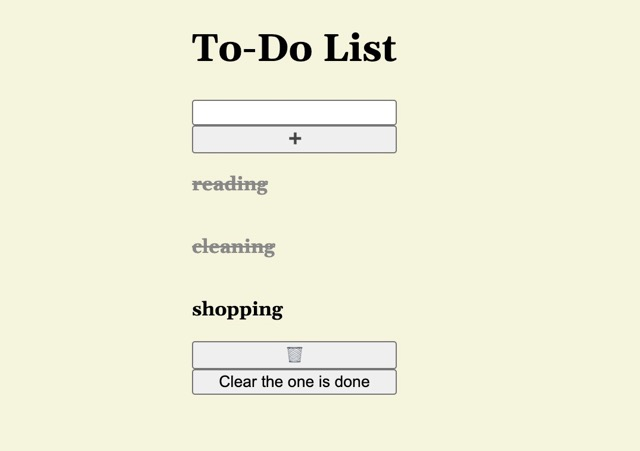

# 📝 To Do List

A lightweight to-do list that lets you add tasks, mark them as done, and clear them out.

## Demo

Live: [https://todo-list-rc-alpha.vercel.app/](https://todo-list-rc-alpha.vercel.app/)

## Screenshots




## Features

- Add new tasks with the input box and the + button
- Click a task to mark it as done (it gets a strikethrough)
- Clear all completed tasks with one button

## Built With

- HTML5
- CSS3
- JavaScript
- Deployed on [Vercel](https://vercel.com/)

## Getting Started

1. Clone the repo
   ```bash
   git clone https://github.com/sabrinalindev/todo-list.git
   cd todo-list
   ```
2. Open `index.html` in your browser